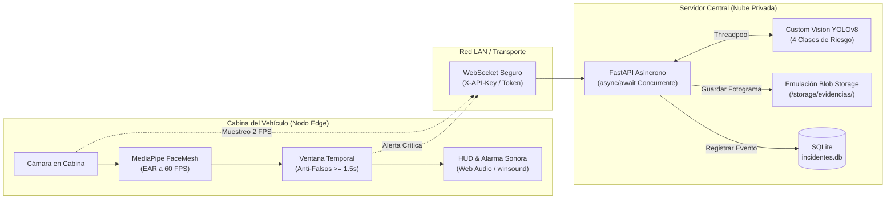

# FleetGuard DMS 🛡️
### Sistema Inteligente de Monitoreo de Fatiga y Distracción en Cabina

[](https://fastapi.tiangolo.com)
[](https://ultralytics.com)
[](https://mediapipe.dev)
[](https://www.docker.com/)
[](https://www.sqlite.org/)

Ecosistema distribuido de visión artificial en tiempo real diseñado para entornos de transporte interprovincial y carga pesada. El sistema detecta microsueños ($\ge 1.5\text{ s}$), distracciones y uso de dispositivos móviles al volante, diferenciando parpadeos normales de fatiga real mediante una arquitectura asíncrona híbrida (Edge + Nube Privada).

---

## 🏛️ Arquitectura del Sistema



---

## 📂 Estructura del Repositorio y Descripción de Archivos

```text
fleetguard-dms/
├── .env                          # Configuración de variables de entorno activas (API_KEY, PUERTO)
├── .env.example                  # Plantilla de variables de entorno para despliegue
├── captura_dataset.py            # Script interactivo para captura de dataset con webcam (4 clases)
├── cliente_vehiculo.py           # Cliente Edge en OpenCV (Rol Integrante B) con HUD y telemetría
├── docker-compose.yml            # Orquestación del contenedor servidor (FastAPI + Uvicorn)
├── entrenar_yolo.py              # Pipeline para división de dataset (80/20) y entrenamiento YOLOv8
├── README.md                     # Documentación general y guía técnica del proyecto
├── REPORTE_TECNICO.md            # Reporte formal de sustentación (Secuencia, Ancho de Banda y Azure)
├── server/
│   ├── ai_engine.py              # Motor de inferencia YOLOv8 (evaluación de conductas de riesgo)
│   ├── best.pt                   # Pesos del modelo YOLOv8 entrenado para las 4 clases de cabina
│   ├── Dockerfile.dev            # Definición del entorno Docker (Python 3.10-slim + OpenCV + Uvicorn)
│   ├── main.py                   # Servidor FastAPI principal, WebSockets, autenticación y endpoints REST
│   ├── models.py                 # Esquema SQLAlchemy y persistencia en SQLite (incidentes.db)
│   ├── requirements.txt          # Dependencias Python del backend (uvicorn[standard], websockets, etc.)
│   ├── static/
│   │   └── index.html            # Dashboard web interactivo de cabina con MediaPipe FaceMesh
│   └── storage/
│       ├── incidentes.db         # Base de datos SQLite local (historial de incidentes)
│       └── evidencias/           # Directorio estructurado emulador de Azure Blob Storage
```

### Detalle de Componentes

#### 1. Módulos del Servidor Cloud (`server/`)
* **[server/main.py](file:///c:/Users/Alumno/Documents/1412994/seminari_III/17_11_ip4/fleetguard-dms/server/main.py):** Núcleo asíncrono en FastAPI. Gestiona las conexiones WebSocket entrantes en `/ws/flota/{vehiculo_id}`, valida la capa de seguridad (`X-API-Key` o `?token=`), delega la inferencia de YOLO en hilos asíncronos (`asyncio.to_thread`), guarda las fotos de infracción en disco y expone el endpoint REST `GET /flota/incidentes`.
* **[server/ai_engine.py](file:///c:/Users/Alumno/Documents/1412994/seminari_III/17_11_ip4/fleetguard-dms/server/ai_engine.py):** Motor de visión artificial. Carga el modelo `best.pt` en memoria e infiere sobre los fotogramas recibidos extrayendo la clase (`top1`) y su confianza (`top1conf`).
* **[server/models.py](file:///c:/Users/Alumno/Documents/1412994/seminari_III/17_11_ip4/fleetguard-dms/server/models.py):** Define la tabla `incidentes` (`id`, `vehiculo_id`, `evento`, `duracion_seg`, `confianza_custom`, `evidencia_url`) y gestiona las sesiones de conexión a SQLite.
* **[server/static/index.html](file:///c:/Users/Alumno/Documents/1412994/seminari_III/17_11_ip4/fleetguard-dms/server/static/index.html):** Interfaz web completa de cabina. Ejecuta MediaPipe FaceMesh acelerado por WebGL en la GPU del cliente, calcula el Eye Aspect Ratio (EAR), aplica la ventana temporal de 1.5s, transmite fotogramas a 2 FPS, calcula el ancho de banda (Kbps), emite alertas sonoras con Web Audio API y muestra las evidencias registradas en tiempo real.
* **[server/Dockerfile.dev](file:///c:/Users/Alumno/Documents/1412994/seminari_III/17_11_ip4/fleetguard-dms/server/Dockerfile.dev):** Configuración del contenedor Docker basada en `python:3.10-slim` con soporte de librerías del sistema para OpenCV (`libgl1`, `libglib2.0-0`) y hot-reload.
* **[server/requirements.txt](file:///c:/Users/Alumno/Documents/1412994/seminari_III/17_11_ip4/fleetguard-dms/server/requirements.txt):** Paquetes necesarios para el servidor: `fastapi`, `uvicorn[standard]`, `websockets`, `ultralytics`, `opencv-python-headless`, `SQLAlchemy`.

#### 2. Módulos del Cliente Edge y Scripts Auxiliares
* **[cliente_vehiculo.py](file:///c:/Users/Alumno/Documents/1412994/seminari_III/17_11_ip4/fleetguard-dms/cliente_vehiculo.py):** Cliente en OpenCV diseñado para el **Integrante B (Ingeniero Telemetría & Edge)**. Captura video de la webcam, detecta rostro/ojos con clasificadores Haar, aplica la ventana de 1.5s, reproduce sonido con `winsound` en Windows y transmite telemetría autenticada vía WebSocket.
* **[captura_dataset.py](file:///c:/Users/Alumno/Documents/1412994/seminari_III/17_11_ip4/fleetguard-dms/captura_dataset.py):** Herramienta para recolección de datos en el laboratorio mediante teclado:
  - `[1]` Conducción Segura
  - `[2]` Uso de Celular
  - `[3]` Distracción Lateral
  - `[4]` Sin Conductor
* **[entrenar_yolo.py](file:///c:/Users/Alumno/Documents/1412994/seminari_III/17_11_ip4/fleetguard-dms/entrenar_yolo.py):** Script de entrenamiento que organiza las imágenes en subdirectorios `train` y `val` y ejecuta el entrenamiento con `YOLO('yolov8n-cls.pt')`.
* **[REPORTE_TECNICO.md](file:///c:/Users/Alumno/Documents/1412994/seminari_III/17_11_ip4/fleetguard-dms/REPORTE_TECNICO.md):** Reporte de 2 páginas con diagramas de red, análisis matemático de consumo de ancho de banda y matriz de equivalencia con servicios de Microsoft Azure.

---

## ⚙️ Requisitos Previos

- **Docker Desktop** (con Docker Compose v2+)
- **Navegador Web** (Google Chrome, Microsoft Edge o Firefox con soporte WebGL)
- **Python 3.10+** (únicamente si se ejecuta el cliente OpenCV localmente)
- **Webcam** conectada al equipo

---

## 🚀 Puesta en Marcha y Ejecución

### 1. Iniciar el Servidor Central (Nube Privada)

En una terminal en la raíz del proyecto (`fleetguard-dms`):

```powershell
docker compose up -d
```

Verificar que el contenedor esté corriendo:
```powershell
docker compose ps
```

El servidor estará escuchando en `http://localhost:8000`.

---

### 2. Probar la Cabina Virtual Web (Cliente Edge Primario)

1. Abre tu navegador en:
   ```text
   http://localhost:8000/
   ```
2. Concede los permisos de acceso a la webcam cuando el navegador lo solicite.
3. Observa en la interfaz:
   - Estado de conexión: `● Conectado (BUS-04)` (badge verde).
   - Telemetría en vivo: Consumo de red entre **80 y 160 Kbps** y **~60 FPS**.
   - Indicador de EAR y temporizador de parpadeo (`0.0s / 1.5s`).

---

### 3. Probar el Cliente Edge en OpenCV (Integrante B)

Para ejecutar el cliente nativo en Python simulando un vehículo independiente:

1. Instalar dependencias en el entorno local:
   ```powershell
   pip install opencv-python websockets
   ```
2. Iniciar el cliente:
   ```powershell
   python cliente_vehiculo.py --id BUS-04 --token fleetguard_token_secreto_2026
   ```

---

## 🧪 Pruebas de Sustentación en Vivo (Rúbrica de Evaluación)

### Prueba 1: Demostración de Seguridad (Rechazo HTTP 401)
1. **Petición no autorizada:**
   Abrir en el navegador o ejecutar con `curl`:
   ```powershell
   curl -i http://localhost:8000/flota/incidentes
   ```
   **Respuesta esperada:** Código **`401 Unauthorized`** con mensaje de clave inválida.
2. **Petición autorizada con encabezado `X-API-Key`:**
   ```powershell
   curl -i -H "X-API-Key: fleetguard_token_secreto_2026" http://localhost:8000/flota/incidentes
   ```
   **Respuesta esperada:** Código **`200 OK`** con el listado JSON de incidentes.
3. **Rechazo en WebSocket:**
   En la cabina web, cambiar la API Key por `clave_invalida` y pulsar **Conectar**. El estado cambiará a `✗ Rechazado (Token Inválido)`.

---

### Prueba 2: Lógica Temporal Anti-Falsos Positivos ($\ge 1.5\text{ s}$)
1. **Parpadeo normal:** Parpadear naturalmente (duración de ~0.2 a 0.5s).
   - El HUD mostrará el tiempo de cierre brevemente en amarillo (`0.3s / 1.5s`).
   - **No se dispara ninguna alarma ni se guarda evidencia**.
2. **Microsueño simulado:** Cerrar los ojos durante más de 1.5 segundos.
   - Al superar 1.5s continuos, el marco parpadea en **rojo brillante**.
   - Se reproduce la **alarma sonora**.
   - El servidor guarda automáticamente la foto en `storage/evidencias/BUS-04/` y la muestra en el panel lateral.

---

### Prueba 3: Detección de Conductas de Riesgo con YOLOv8
1. **Uso de celular:** Sostener un teléfono celular cerca del rostro.
   - El servidor clasificará `USO_CELULAR` con alta confianza (> 85%).
   - Se activará la alerta visual y sonora de forma simultánea.
2. **Distracción lateral:** Girar la cabeza hacia un costado de la vía.
   - Se clasificará `DISTRACCION_LATERAL`.
3. **Restablecimiento:** Al volver a mirar al frente sin celular, el estado regresa automáticamente a verde (**"Conducción Segura"**).

---

### Prueba 4: Concurrencia Multi-Cliente (Prueba de Estrés)
Demostrar que el servidor atiende múltiples cabinas concurrentemente sin bloquearse:
1. **Vehículo 1:** Mantener abierta la pestaña web en `http://localhost:8000/?id=BUS-01`.
2. **Vehículo 2:** Abrir una segunda ventana o ejecutar el cliente OpenCV:
   ```powershell
   python cliente_vehiculo.py --id BUS-02 --cam 0
   ```
Ambos nodos transmitirán telemetría e inferencia simultánea sobre el servidor asíncrono.

---

## ☁️ Endpoint de Auditoría Cloud

Para auditar el historial de infracciones y visualizar las fotos de evidencia capturadas:

```http
GET /flota/incidentes?api_key=fleetguard_token_secreto_2026
```

**Respuesta JSON:**
```json
[
  {
    "vehiculo_id": "BUS-04",
    "evento": "USO_CELULAR",
    "duracion_seg": 1.0,
    "confianza_custom": 0.93,
    "evidencia_url": "/storage/evidencias/BUS-04/20261117_152037.jpg"
  },
  {
    "vehiculo_id": "BUS-04",
    "evento": "MICROSUEÑO_DETECTADO",
    "duracion_seg": 1.8,
    "confianza_custom": 1.0,
    "evidencia_url": "/storage/evidencias/BUS-04/20261117_151945.jpg"
  }
]
```

Cada evidencia es accesible en el navegador a través de su URL:
`http://localhost:8000/storage/evidencias/BUS-04/20261117_152037.jpg`.

---

## 👥 Roles del Equipo

- **Integrante A (Ingeniero Cloud & Backend IA):** Servidor asíncrono FastAPI, integración de inferencia YOLOv8 en hilo secundario, almacenamiento simulado Azure Blob Storage, persistencia en SQLite y seguridad con API Key.
- **Integrante B (Ingeniero Telemetría & Edge):** Desarrollo de cliente de cabina en OpenCV y Web, cálculo de geometría ocular (EAR) con persistencia temporal $\ge 1.5\text{s}$, interfaz HUD, alertas sonoras y medición de ancho de banda.
