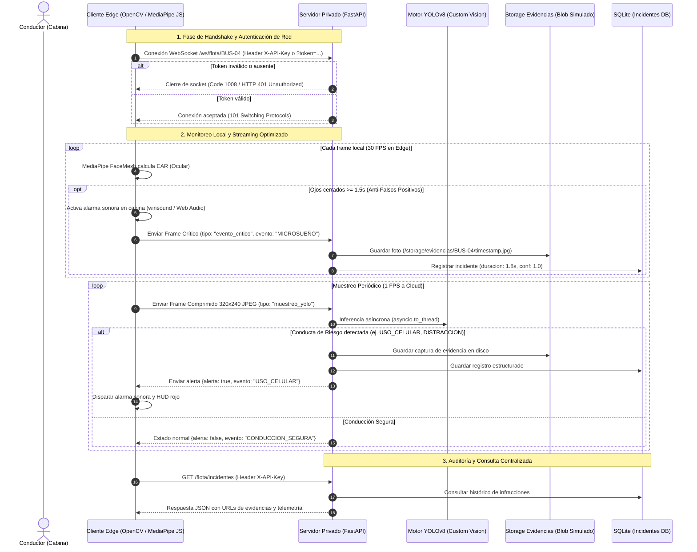

# Reporte Técnico: FleetGuard DMS
**Sistema Inteligente de Monitoreo de Fatiga y Distracción en Cabina**  
*Curso: Seminario de Especialización / Redes & Visión Artificial*  
*Autores: Integrante A (Ingeniero Cloud & Backend) & Integrante B (Ingeniero Telemetría & Edge)*

---

## 1. Diagrama de Secuencia de Red

El siguiente diagrama modela el flujo end-to-end de autenticación, streaming optimizado, inferencia híbrida y almacenamiento persistente de evidencias:

---

## 2. Cálculo de Ancho de Banda en la LAN

Para evitar la saturación de la red y permitir escalabilidad a decenas de vehículos simultáneos, se implementó una **estrategia de streaming híbrido y asimétrico**:

1. **Parámetros de Captura y Compresión:**
   - Resolución enviada: $320 \times 240$ píxeles (downsampled desde $640 \times 480$).
   - Formato de compresión: JPEG dinámico con factor de calidad $Q = 70\%$.
   - Tamaño promedio de cada frame comprimido en binario: $B_{frame} \approx 7.5\text{ KB} = 60{,}000\text{ bits}$.
   - Sobrecarga de codificación Base64 para WebSocket ($+33\%$):  
     $$B_{payload} \approx 7.5\text{ KB} \times 1.33 \approx 10\text{ KB} = 80{,}000\text{ bits}$$

2. **Frecuencia de Transmisión por Vehículo:**
   - La visión de alta frecuencia (MediaPipe EAR) se procesa **en el Edge** a $30\text{ FPS}$ con un costo de red de **$0\text{ Kbps}$**.
   - A la nube privada se transmite únicamente un muestreo de **$1\text{ FPS}$** para la detección con YOLOv8, más ráfagas ocasionales ante eventos críticos ($< 0.1\text{ FPS}$).

3. **Cálculo de Tasa de Transferencia:**
   $$\text{Ancho de Banda por Vehículo} = 10\text{ KB/frame} \times 1\text{ frame/seg} \times 8\text{ bits/byte} \approx 80\text{ Kbps} \quad (0.08\text{ Mbps})$$

4. **Escalabilidad Multi-Cliente en la LAN del Laboratorio:**
   - **Para 2 clientes concurrentes (Prueba de Estrés):** $2 \times 80\text{ Kbps} = 160\text{ Kbps}$ ($0.16\text{ Mbps}$).
   - **Para una flota de 50 buses en ruta:** $50 \times 80\text{ Kbps} = 4{,}000\text{ Kbps} = 4.0\text{ Mbps}$.
   - **Conclusión:** El sistema reduce el consumo de red en más de un **$96\%$** respecto a un streaming de video continuo en crudo ($640 \times 480$ @ 30 FPS requeriría $> 2.5\text{ Mbps}$ por vehículo).

---

## 3. Mapeo de Arquitectura Equivalente en Microsoft Azure

| Componente Local (FleetGuard DMS) | Servicio Equivalente en Microsoft Azure | Justificación Técnica y Beneficios en Producción |
| :--- | :--- | :--- |
| **Edge Facial (MediaPipe / OpenCV)** | **Azure IoT Edge + Container Runtime** | Despliegue de contenedores Docker en dispositivos de cabina (NVIDIA Jetson / Raspberry Pi 5) gestionados centralmente desde la nube con Azure IoT Hub. |
| **Custom Vision YOLOv8 (4 clases)** | **Azure AI Vision / Custom Vision** | Entrenamiento e inferencia de modelos de clasificación y detección de objetos de baja latencia con aceleración por GPU. Permite reentrenar con un clic y exportar en formato ONNX/TensorRT. |
| **Servidor Central FastAPI** | **Azure App Service / Azure Container Instances (ACI)** | Alojamiento serverless o gestionado con soporte de WebSockets, autoescalado horizontal automático (HPA) ante picos de concurrencia y balanceo de carga. |
| **Directorio Local de Evidencias (`/storage`)** | **Azure Blob Storage (Tier Hot/Cool)** | Almacenamiento distribuido de objetos de alta durabilidad (99.999999999%), con generación de URLs seguras mediante Shared Access Signatures (SAS) y políticas de retención automática. |
| **Base de Datos SQLite (`incidentes.db`)** | **Azure SQL Database / Cosmos DB** | Base de datos relacional administrada con cifrado de datos en reposo (TDE), alta disponibilidad y auditoría de eventos de telemetría de la flota en tiempo real. |
| **Autenticación API Key** | **Azure API Management (APIM)** | Puerta de enlace (API Gateway) para validación estricta de tokens, limitación de tasa (rate limiting), firewall de aplicaciones web (WAF) y reporte de métricas de red. |

---

## 4. Conclusiones
El diseño híbrido propuesto distribuye la carga computacional eficientemente: traslada los cálculos de geometría temporal de alta tasa (EAR) al cliente Edge para eliminar falsos positivos de parpadeo ($\ge 1.5\text{ s}$), mientras centraliza el modelo Custom Vision en la nube privada asíncrona, garantizando seguridad, almacenamiento duradero y bajo consumo de ancho de banda.
